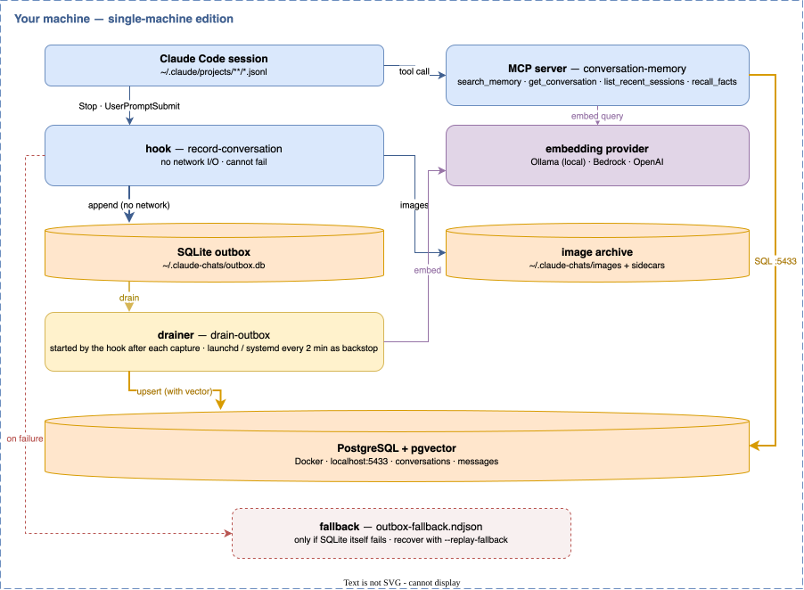

# claude-chats — single-machine edition

Records your Claude Code conversations to a local PostgreSQL with vector
embeddings, and exposes them to Claude through an MCP server so it can search
everything you have ever discussed.

Everything runs on one machine. There is no server to build, no message broker,
no cloud account and no second host. If you want the distributed version — where
several machines share one database behind a queue — see the [repository
root](../README.md).

## Support

If you find this useful, please consider buying me a coffee:

[](https://www.paypal.com/donate?hosted_button_id=Q3BESC73EWVNN&custom=claude-chats)

## Install

```bash
git clone https://github.com/nakomis/claude-chats.git
cd claude-chats/localhost
./install.sh
```

It needs Docker, uv, Claude Code and an embedding provider (Ollama by default).
Full details, including the maintenance commands, are in
**[INSTALL.md](INSTALL.md)**. Installed from an older checkout? Re-run
`./install.sh` — see [Upgrading](INSTALL.md#upgrading-from-before-october-2026).

## How it works



A hook fires on every user message and again at session end. It reads the
session transcript, works out which messages are new, and appends them to a
local SQLite outbox. That is all it does in the foreground: no network I/O, no
credentials, nothing that can be "down", so a stopped database or a dead
embedding provider can delay a message but never lose it.

Then the hook starts `drain-outbox` as a detached background process and
returns without waiting for it. The drain embeds the new messages and writes
them to Postgres, usually within a second or two, and blanks each outbox row
once Postgres has committed it. If anything is down, the rows stay in the
outbox; a LaunchAgent (macOS) or systemd user timer (Linux) runs the same drain
every two minutes as the backstop, so they are delivered as soon as it is back.

Two drains can be running at once — the hook's and the timer's, or two hooks'
from two sessions — so they take turns on a lock file beside the outbox, and the
one holding it keeps going until the outbox is empty. Writes are upserts keyed
on each message's id as well, so even a drain that slipped past the lock would
rewrite the same rows rather than duplicate them.

This is the same split the distributed edition uses, with its forwarder, SQS
queue and remote consumer collapsed into one local process.

*Diagram source: [`docs/architecture/`](docs/architecture). The SVG is
regenerated on commit by the repository's `githooks/pre-commit`.*

### Why there is no longer a `direct` mode

Earlier versions could also run the hook in `direct` mode, embedding and writing
to Postgres from inside the hook. It was simpler and immediate, but it put
Docker, Postgres and the embedding provider on the capture path — exactly the
arrangement whose silent failures the outbox was invented to fix — and it meant
maintaining a second write path that the distributed edition never used. The
background drain makes the outbox just as immediate in practice, so `direct`
was removed. Re-running `./install.sh` moves a `direct` install over; nothing
already recorded is touched.

## What is shared, and what is not

This directory holds only what is specific to running on one machine. The code
is the repository's own, the same code the distributed edition runs:

| Shared, at the repository root | |
|---|---|
| [`../hook`](../hook) | The capture hook, `drain-outbox`, `replay-fallback`, `backfill-embeddings`, and the one embedding helper |
| [`../mcp`](../mcp) | The MCP server, which uses the hook's embedding helper |
| [`../init.sql`](../init.sql) | The schema; `docker-compose.yml` mounts it, and `install.sh` re-applies it on every run |
| [`../scripts/backup.sh`, `restore.sh`](../scripts) | Backups. `--s3` is their default; `install.sh` always passes `--local`, which keeps the newest 14 dumps (`CLAUDE_CHATS_BACKUP_KEEP`) |

| Here, and why it stays separate | |
|---|---|
| `install.sh` | Starts Postgres in Docker, registers the hook with `CLAUDE_CHATS_DRAIN_AFTER_CAPTURE=1` and the MCP server, installs the drain schedule. The distributed edition is installed from two repositories and has none of these steps. |
| `docker-compose.yml` | The local Postgres. It stays in this directory because Compose names the data volume after it (`localhost_pgdata`); moving it would orphan existing databases. |
| `launchd/`, `systemd/` | The drain schedule. Only this edition drains locally: in the distributed edition the forwarder owns the outbox, and a local drain would compete with it. |
| `hook/pyproject.toml` | No code: a stand-in for the hook package that used to live here, resolving to `../../hook`. Installs from before October 2026 run their hook from this path until `install.sh` is re-run, and without it a `git pull` would leave them failing in a way Claude Code takes as "block the prompt". |
| `README.md`, `INSTALL.md`, `docs/` | This edition's documentation. |

`tests/test_localhost_layout.py` fails if any `.py` or `.sql` file appears here
again: the previous copies drifted months behind the originals within weeks.

## What you get

MCP tools, available to Claude in any project once you restart Claude Code:

| Tool | What it does |
|---|---|
| `search_memory` | Hybrid semantic + full-text search across every recorded message |
| `get_conversation` | Fetch a full transcript by session id |
| `list_recent_sessions` | Browse what has been recorded lately |
| `recall_facts` | Durable facts extracted from conversations. Empty unless you also run the [facts extractor](../facts/README.md), which needs an Anthropic API key |

Each message records who produced it — you, Claude or a tool (and which tool,
or which model) — so what you typed can be told apart from command output.

Images you paste into Claude are archived too, under `~/.claude-chats/images`,
each with a JSON sidecar recording where it came from. A search hit that mentions
an image can be resolved back to the actual picture by its sha256.

## Support

If you find this useful, please consider buying me a coffee:

[](https://www.paypal.com/donate?hosted_button_id=Q3BESC73EWVNN&custom=claude-chats)
